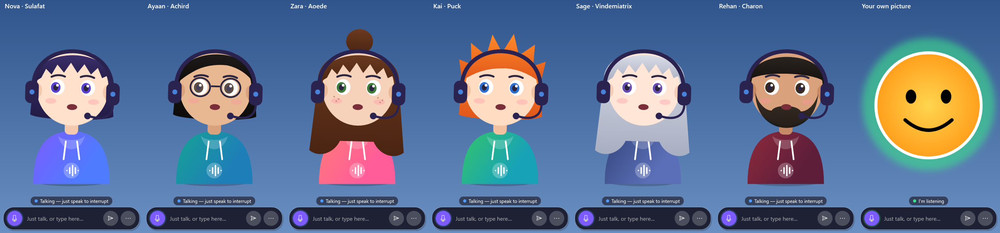

<p align="center"></p>

# VoxStride

**Your AI companion on the Windows desktop.** A friendly character lives on your screen. You talk to it like a person, it talks back in real time, and it does things on your PC for you: opening apps, working with your files, searching the web, building Excel sheets and looking at your screen when you ask.

<p align="center"></p>

- **Talk like a person.** Real-time voice through Gemini Live: it answers in about a second, you can interrupt it, and there's no "proceed".
- **It does things.** "Check the weather in France and put it in an Excel sheet" searches the web, creates the sheet and opens it.
- **It sees your screen when you want it to.** "What does this error mean?", "translate this page". You choose: ask each time, whenever it needs to, or never.
- **Six characters, or your own picture.** Each character has its own look, voice and personality. There are 30 natural voices, and you can give it any personality you like.
- **It remembers you**, and the memories stay on your PC. You can see and delete them any time.
- **Twitch co-host.** It reads your stream chat, thanks subs and raids, and reacts to viewers out loud. Viewers can never make it do anything on your PC.
- **Safe by design.** Every action goes through a typed, audited tool layer: no shell, no scripts, no admin rights. Anything that can't be undone (deleting, sending, paying, submitting) waits for your spoken "yes" or a click.
- **Offline option.** With Ollama and a strong graphics card, VoxStride can use a local AI model instead of the cloud.

[](https://github.com/nisar87/VoxStride/actions/workflows/ci.yml)

## Get it
1. Download `VoxStride-Setup-<version>-x64.exe` from the latest [release](https://github.com/nisar87/VoxStride/releases/latest) and run it. It installs for your user, with no admin rights needed. After that, VoxStride updates itself.
2. In **Reasoning providers**, add a **Gemini API key** from [Google AI Studio](https://aistudio.google.com). The character appears and starts listening.
3. Say "Hi!"

The installer is unsigned for now; check it against `SHA256SUMS.txt`. See [docs/installation.md](docs/installation.md).

## Try saying
- "Hi, how are you?" … then just chat
- "Check the weather in France and put it in an Excel sheet"
- "What's on my screen?" / "What does this error mean?"
- "Remember that my sister is called Ayesha"
- "How much space is left on C?"
- "Organize my desktop by file type, but leave the zip files alone" … then "undo that"
- "Move the PDFs in Downloads into a folder called Invoices"
- "Search YouTube for lofi beats and play the third video in the top row"
- "Delete the old screenshots on my desktop" → it asks first, and you say "yes"

**Shortcuts**:
- **Ctrl+Alt+V**: talk, or mute/unmute.
- **Ctrl+Alt+X**: stop talking.
- **Ctrl+Alt+M**: mute.
- Right-click the character for its menu. Drag it anywhere, and resize it with Ctrl + mouse wheel.

## How it works
| Mode | Needs | What it's like |
|---|---|---|
| **Live companion** (default) | Gemini API key | Real-time conversation; actions run when you ask; irreversible ones need a spoken "yes" |
| **Classic voice** | Any AI key (Claude, Gemini, OpenAI) or Ollama | "Hey VoxStride" → speak with pauses → "VoxStride, execute"; the character follows along |
| **Offline** | Ollama + a GPU with 8 GB+ | Classic voice with a local model; nothing leaves the PC |

Simple commands (drive space, opening apps, organizing folders, cleanup, undo) run locally without any AI.

## Status
Version 0.9 is feature-complete for the plan and the companion design. **442 automated tests** pass on Windows and Linux CI. The installed app also runs a companion self-test on a real Windows machine. That self-test renders every character and state, and runs a scripted conversation through the real tools: it creates an Excel sheet without "proceed", looks at the screen, deletes a file only after a spoken "yes", and refuses changes nobody asked for (including from Twitch viewers). It also stops talking when interrupted.

At rest, with the character on screen, it uses about **0.3 % CPU**. These still need a real-world run: Google's Gemini Live service, Twitch's chat server and an Ollama model can't be reached from CI. Details: **[docs/progress.md](docs/progress.md)**.

## Documentation
| | |
|---|---|
| [User manual](docs/user-manual.md) | Using VoxStride day to day |
| [Installation & build](docs/installation.md) | Install, build from source, package |
| [Architecture](docs/architecture.md) | Components, live companion, command lifecycle |
| [Threat model](docs/security/threat-model.md) | Trust boundaries and mitigations, mapped to tests |
| [Acceptance tests](docs/acceptance-tests.md) | Automated mapping and manual scripts |
| [Traceability](docs/traceability.md) | Requirement → code → test → status |
| [Progress](docs/progress.md) · [Roadmap](docs/roadmap.md) | What's verified and what's next |
| [Research](docs/research.md) · [ADRs](docs/adr/) | Technology choices (ADR-0013: live companion) |
| [Release notes](docs/releases/) | What changed in each version |
| [Specification](docs/VoxStride_Master_Implementation_Plan.md) | Product contract |

## Build
```powershell
dotnet restore VoxStride.sln
dotnet build VoxStride.sln -c Release
dotnet test VoxStride.sln -c Release
dotnet run --project src/VoxStride.Desktop
```
Requires Windows 10 2004+/11 x64 and the .NET 10 SDK.

## Licence
Proprietary, all rights reserved. See [LICENSE](LICENSE) and [THIRD-PARTY-NOTICES.md](THIRD-PARTY-NOTICES.md). The characters are original VoxStride designs.
