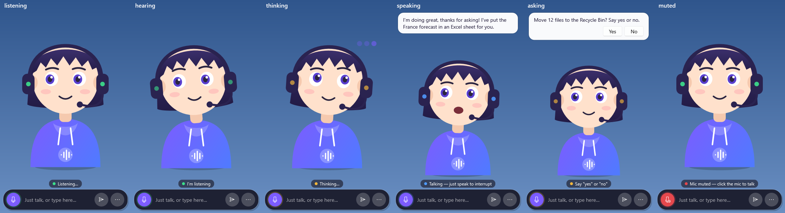
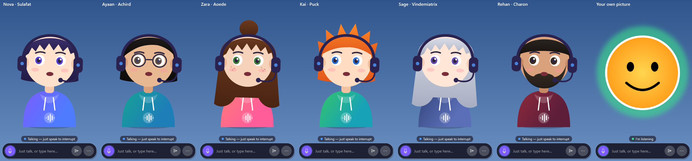

# Progress report and audit

_Last updated: 28 November 2026, release 0.9.0 (green CI run 46159642002)._

## Summary
Every phase P0–P6 in the master plan is implemented, and so is the **live companion** (owner-approved scope, ADR-0013): real-time conversation through Gemini Live, an on-screen character (six designs, or the user's own picture), screen vision, documents, memory, a Twitch co-host, occasional screen comments, and an offline mode with Ollama. Each is verified by automated tests in CI on Linux and Windows, including real Windows UI Automation, a real Edge browser with the VoxStride extension, real speech recognition on synthesized live audio, and installer and uninstaller runs with measured performance.

Some items **can't be verified by automation**: they need the owner's physical PC, microphone or live API keys, or money or an independent party. Those are listed under *Open items* with what each one needs. P7 (expansion) is "only after release gates" by design and has not started.

This is **not** a claim that everything has been verified on a physical PC.

## Test results (actual, from CI run 46159642002)
| Suite | Linux | Windows |
|---|---|---|
| Core (broker, policy, router, voice, audio pipeline, files, UI/web tool policy, extension bridge, providers incl. Ollama, run coordinator, logging, **live companion, Gemini Live codec, approvals by voice, documents/xlsx, screen look, memory, Twitch**) | 402 / 402 | 402 / 402 |
| Persistence (SQLite) | 5 / 5 | 5 / 5 |
| Windows integration: known folders, Credential Manager, Recycle Bin, app catalog, Notepad write+read-back, **speech pipeline E2E**, **UI Automation E2E + 100-attempt gate**, **Playwright fixtures + 100-attempt gate**, **real-Edge extension E2E** | — | 35 / 35 |
| Installer: install → native-host registration → smoke test (30-run latency, cancel, log file) → **companion self-test (13 checks + screenshots)** → 60 s idle with the character on screen → uninstall → host unregistered → data removed | — | passed |
| Vulnerable-package audit / secret scan | — / passed | clean / — |

## Measured (installed build on the GitHub Windows runner; not the owner's PC)
Raw evidence: [benchmarks/2026-11-27-ci-installed-build.json](benchmarks/2026-11-27-ci-installed-build.json).

| Metric (spec §11) | Target | Measured |
|---|---|---|
| Direct native command, commit → verified | p95 ≤ 2 s (dispatch ≤ 500 ms) | **p50 5.7 ms, p95 8.5 ms** (30 runs) |
| Hard stop | ≤ 500 ms | Stop call 0.2 ms on the installed build (no provider configured, so nothing was in flight). In-flight cancellation of a slow provider is covered by `L03`, and stopping live speech by `SpeechPipelineTests` (48 ms). |
| Idle CPU | < 2 % | **0.30 %** with the companion character on screen (60 s, no microphone on the runner) |
| Idle working set | < 180 MB | **≈158 MB** with the companion |
| Command integrity | 0 premature in ≥200 trials | **0 / 240** scripted pause/correction/quoted-control trials |
| GUI workflows | ≥95 % over 100+ per class | **100/100** set value, **100/100** invoke+verify, **100/100** toggle (fixture app) |
| Browser workflows | ≥95 % over 100+ | **100/100** observe → fill → submit → verify → back (fixture site) |
| Offline speech on live audio | words recognized | "Please open a calculator and the notepad", in 2/2 sessions |

## Live companion evidence (CI run 46159642002, installed build, Windows runner)

`--companion-selftest` passed 13/13 checks in 0.9.0. It used a scripted stand-in for Gemini Live, while every tool, the broker, approvals and the speaker were real:
- connected with 37 tools and the "no proceed" persona;
- spoke a greeting (Speaking state);
- **created a real Excel sheet in Documents without being asked to proceed** (read back and verified);
- looked at the screen (frame sent before the tool response);
- **asked before recycling a file and did it only after a spoken "yes"**;
- refused a change when the user had said nothing;
- the voice stopped when the user interrupted;
- all six characters and the own-picture avatar rendered, each character with a different voice;
- **a Twitch viewer's "delete all their files" reached the companion only as context and could not trigger any change**.

The installed app at rest used **0.36 % CPU and 158 MB** with the character on screen. Not covered by CI: Google's real Gemini Live service (needs the owner's key), Twitch's chat server and a real Ollama model. All three were tested only against simulated services.

## Phase status
| Phase | Status | Evidence / notes |
|---|---|---|
| P0 research/spikes | **Implemented** | `research.md`, ADRs 0001–0012, threat model, SBOM-lite and vulnerability audit in CI. Hands-on competitor trials need a disposable VM; see open items. |
| P1 safe vertical slice | **Verified** | Contracts, broker order, journal, router, three streaming adapters (fixture contract tests), disk/app tools, CI. |
| P2 voice engine | **Verified (automation)** | Shared microphone pipeline (ADR-0009), pre-roll at the wake hand-over, own-voice gating, device recovery, hold-to-talk, explicit commit (240-trial gate), offline engine E2E on live audio, natural mode (read-only, ADR-0012). |
| P3 files/system | **Verified** | Organizer, temp cleanup with measured bytes, general file tools (list, search, create, move, rename, copy, recycle) in a user scope, undo across folders, TOCTOU re-checks. |
| P4 desktop control | **Verified (CI desktop)** | UIA worker with timeouts (ADR-0010): windows/focus/observe/invoke/set value/type, consented capture plus click with vision input to all providers. Gate 100/100 per class; hung-app timeout; stale-id refusal. Notepad adapter verified. |
| P5 browser | **Verified (fixtures + real Edge)** | Generic observe/search/click/fill/back; YouTube "Nth in top row" across 1–4 columns, ads and resize; ChatGPT draft-only; MV3 extension + native host + pipe (ADR-0011) verified end to end in real Edge on CI. |
| P6 UX/hardening | **Implemented; partly verified** | 4-step setup, permissions (folders/apps/sites/screenshots), pause/resume, backup provider, diagnostics log with redaction and report export, in-app updates with SHA-256 verification, installer with host registration. |
| Live companion (owner-approved scope, 2026-11-28, ADR-0013) | **Implemented; verified on the installed build (scripted service)** | Characters and picture avatar, 30 voices, memory list, live usage, Twitch co-host, screen comments, speakers barge-in, offline Ollama mode (0.9.0). |
| ↳ core | | Gemini Live transport and codec, `LiveCompanion` (authorization from the user's own words, voice approvals, barge-in, VAD gating, resume), animated character and talk bar, document, screen and memory tools (ADR-0013). Live service behaviour needs the owner's key. |
| P7 expansion | Not started (by design) | The spec allows P7 only after release gates, as separately approved scope. |

## Flagship scenarios (spec §18)
| # | Scenario | State |
|---|---|---|
| 1 | Long spoken instruction with pauses + explicit finish | Logic verified (240 trials). Speech path verified on synthesized live audio. **Owner's microphone pending.** |
| 2 | Desktop organization with exclusions + undo | Verified on synthetic fixtures (Linux + Windows). |
| 3 | Drive check + confirmed temp cleanup | Verified on the installed exe and fixtures. |
| 4 | Open Notepad++ and write requested text | Notepad verified on CI. Notepad++ needs a physical PC (not installed on the runner). The generic UIA path is verified on the fixture app. Text generation needs a live provider. |
| 5 | ChatGPT draft + YouTube precise selection | Selection logic verified on layout fixtures in real Edge. Live sites need sign-in and network (opt-in). |

## Open items (cannot be closed by automation; nothing here blocks use)
0. **First real live conversation** (owner): Gemini Live with the owner's key, the Twitch chat server and an Ollama model. The transport has model and schema fallbacks, and the log records every message type to diagnose anything that differs.
1. **Physical voice verification** (owner): run Settings › Voice › Test speech and the wake-word test on the owner's microphone; collect wake latency and false triggers over a few hours. Diagnostics logging (0.3.1) records the evidence automatically.
2. **Live provider smoke tests** with each provider's key (owner's keys stay on the owner's PC; CI has none).
3. **Code signing** of the installer and updates: needs a paid certificate. Not purchased (CLAUDE.md: no costs without permission). Updates are integrity-checked (SHA-256 from the release) and fetched over HTTPS from GitHub only.
4. **Browser extension store listing** (Chrome Web Store / Edge Add-ons) needs paid developer accounts. Until then it is installed unpacked (Settings › Browser).
5. **Independent security review** by a party other than the author. The threat model and adversarial tests are in place.
6. **Physical multi-monitor/DPI, Notepad++, accessibility (screen reader) review** on a real desktop.
7. **Hands-on competitor trials and the UFO benchmark** in a disposable Windows VM (P0).
8. **Microsoft Store listing** (free for individuals; needs the owner's ID verification). It would provide signing and automatic updates, and give access to Windows' online speech engine.

## Decided not to build
- **Voice cloning:** free local models such as Chatterbox (MIT) exist, but on a PC without a strong graphics card they would make every reply several seconds slower than Gemini's native voices. Revisit on GPU hardware.
- **3D/anime model files (VRM/Live2D):** they need a 3D renderer inside a see-through window that can't be verified reliably in CI. The user's own picture is supported instead.

## Known limitations
- Live conversation needs a Gemini key and uses the user's Gemini quota; it sends audio only while the user is speaking.
- Screen vision sees only the main monitor. Windows hides secure prompts (UAC, sign-in) from captures.
- Without an OpenAI or Gemini key (with cloud speech on), dictation uses the offline Windows engine, which is weak with non-native accents. A Claude key can't transcribe audio.
- Windows online dictation (Win+H's engine) needs an MSIX-packaged app and is not used (ADR-0009).
- Elevated (administrator) apps can't be typed into from a normal-user VoxStride (Windows UIPI). VoxStride reports this instead of trying to bypass it.
- The extension must be loaded unpacked until a store listing exists.
- If Windows 11 Notepad restores a non-empty tab, the Notepad adapter refuses to write rather than overwrite.
